# Lifecycle Overview

One complete procurement lifecycle for PrequaliQ. Capability coverage of TendSign + e-Avrop — **not** two parallel products.

## Flow

```mermaid
flowchart LR
  Onboard[0_Onboard] --> Planera[1_Planera]
  Planera --> Underlag[2_Underlag]
  Underlag --> Annonsera[3_Annonsera]
  Annonsera --> QA[4_QA]
  QA --> Anbud[5_Anbud]
  Anbud --> Provning[6_Provning]
  Provning --> Eval[7_Utvardering]
  Eval --> Award[8_Tilldelning]
  Award --> Standstill[9_Avtalsspärr]
  Standstill --> Contract[10_Avtal]
  Contract --> Avrop[11_Ramavtal_Avrop]
```

## Steps → plans

| Step | Name | Primary user | Plan IDs |
|------|------|--------------|----------|
| 0 | Onboard | Admin + Buyer + Supplier | 01–05, 06–09 |
| 1 | Planera (procedure setup) | Buyer | 10 |
| 2 | Underlag (requirements) | Buyer | 11, 15, 31 |
| 3 | Annonsera (publish) | Buyer | 12, 37 |
| 4 | Q&A | Buyer + Supplier | 14, 36 |
| 5 | Anbud (bid) | Supplier | 13, 16, 17, 32, 33 |
| 6 | Prövning (qualification) | Buyer | 09, 15, 18, 34 |
| 7 | Utvärdering (evaluation) | Buyer | 19, 35 |
| 8 | Tilldelning (award) | Buyer | 20, 38 |
| 9 | Avtalsspärr (standstill) | Buyer | 20 |
| 10 | Avtal (contract) | Buyer (+ Supplier view) | 21, 25 |
| 11 | Ramavtal / Avrop / DIS | Buyer (+ Supplier respond) | 22–24 |

## Roles

- **Buyer** = Procuring Entity — owns the procedure from plan to call-offs.
- **Supplier** — profile, find tenders, ask Q&A, bid, complements, see outcomes.
- **Admin** — eligibility approval and feature entitlements; not the day-to-day tender workflow.

## AI placement

AI extras (30–40) attach to the **same** step and portal. They do not create a second process.

## Related

- [00-feature-parity-checklist.md](00-feature-parity-checklist.md)
- [00-ui-objects.md](00-ui-objects.md)
- [00-competitive-positioning.md](00-competitive-positioning.md)
